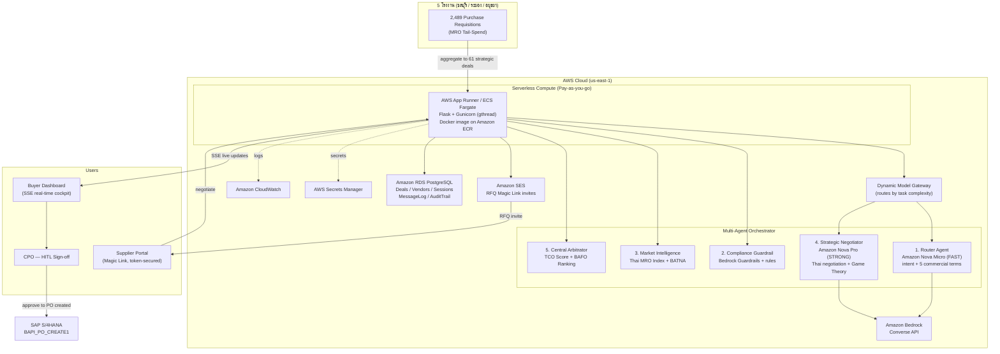

# AutoProcure.AI — AWS Architecture Diagram

> Render this Mermaid diagram (GitHub / VS Code Mermaid preview / mermaid.live) and
> export to PNG for the presentation PDF.

## AWS Services Used
| Service | Purpose |
| :--- | :--- |
| Amazon Bedrock (Converse API) | LLM inference — Nova Micro (router) + Nova Pro (negotiator) |
| Amazon Bedrock Guardrails | Prompt-injection / content policy filtering |
| AWS App Runner / ECS Fargate | Serverless container runtime (pay-as-you-go) |
| Amazon ECR | Container image registry |
| Amazon RDS (PostgreSQL) | Relational store: deals, vendors, sessions, audit trail |
| Amazon SES | RFQ Magic Link email invitations |
| AWS Secrets Manager | Secrets (DB creds, keys) |
| Amazon CloudWatch | Logs & metrics |
